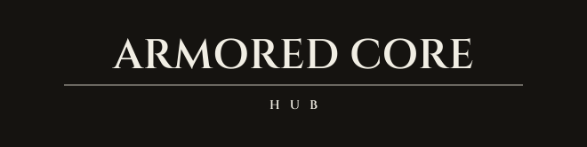
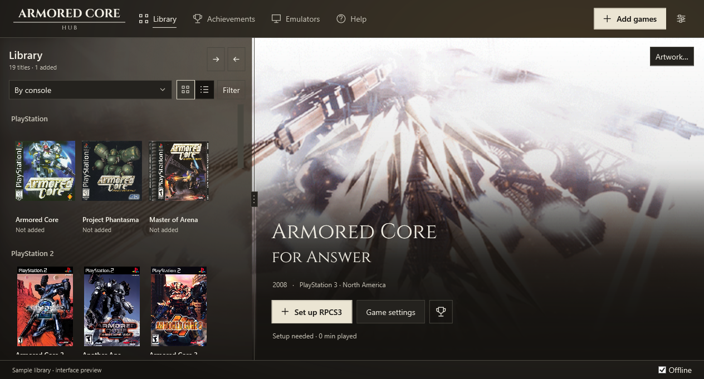

<p align="center">
  
</p>

<p align="center">A portable Windows launcher for the earlier Armored Core games.</p>

<p align="center">
  <a href="https://github.com/peachyGT/armored-core-hub/releases">Download</a> ·
  <a href="docs/usage.md">User guide</a> ·
  <a href="https://github.com/peachyGT/armored-core-hub/issues">Report a bug</a> ·
  <a href="CONTRIBUTING.md">Contribute</a>
</p>

<p align="center">
  <a href="https://github.com/peachyGT/armored-core-hub/actions/workflows/build.yml"></a>
  <a href="https://github.com/peachyGT/armored-core-hub/releases"></a>
  <a href="LICENSE"></a>
</p>



Keep your collection, emulator setup, controls and saves in one place. The Hub covers PlayStation, PlayStation 2, PSP, PlayStation 3 and Xbox 360 editions through DuckStation, PCSX2, PPSSPP, RPCS3 and Xenia Canary.

**This is an early preview.** Opening gameplay has been checked for several editions; full-game compatibility is not certified. See the [feature matrix](docs/feature-matrix.md) and [known limits](BLOCKED.md) before relying on a particular feature or game.

## What it does

- Identifies local game files and regional editions, including games inside supported ZIP, 7z and RAR archives.
- Sets up pinned emulator builds and keeps settings separate for each edition. Games can share an installed build.
- Groups the library by console or generation, with an adjustable library pane and cinematic backgrounds when local media supports them.
- Lets you edit keyboard and controller bindings by game action, with separate Default, Community, Custom and imported profiles.
- Provides graphics settings, local patch management, verified save backups and time played.
- Tracks supported native trophies and achievements, or RetroAchievements sets where available. Not every game has a set.
- Warns before closing a running game and stops emulator/helper processes launched by the Hub when it exits.


The previews use the real native interface and a sample library. Game artwork belongs to its respective owners. No game files or artwork collection are included in the download.

## Get started

1. Download the Windows x64 ZIP from [Releases](https://github.com/peachyGT/armored-core-hub/releases) and extract it into a writable folder.
2. Run `ArmoredCoreHub.exe`. The package includes .NET; no separate installation is needed.
3. Choose **Add games** and select your local files or collection folder.
4. Follow the selected game's checklist to install its emulator and add any required system files, then choose **Play**.

Windows 10 or 11 x64 is required. Emulator hardware requirements still apply. PS1 and PS2 need compatible BIOS dumps; PS3 needs official system software. ZIP and 7z BIOS imports are supported. See the [user guide](docs/usage.md) for formats, settings and troubleshooting.

## Build

Install the [.NET 10 SDK](https://dotnet.microsoft.com/download/dotnet/10.0), then run:

```powershell
.\scripts\build.ps1 -Test -Publish
```

Tests use synthetic media. Real games, BIOS, firmware, saves and account credentials are not test fixtures. The [architecture](docs/architecture.md) and [contribution guide](CONTRIBUTING.md) describe the source layout and checks.

## License and legal

Hub code is [MIT licensed](LICENSE). Fonts, libraries and other components retain their [own licenses](THIRD-PARTY-NOTICES.md).

Use only game files and system dumps you are legally entitled to use. The Hub does not supply commercial games or BIOS files. Emulator binaries and PS3 firmware are not bundled. Read the [legal notice](LEGAL.md).

This is an independent project, unaffiliated with FromSoftware, Bandai Namco, Sony, Microsoft or emulator authors.
