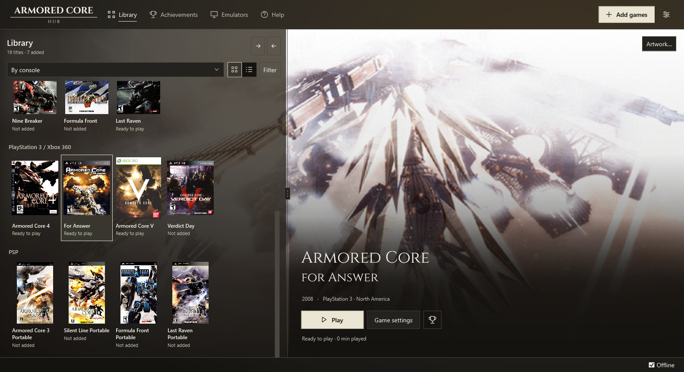
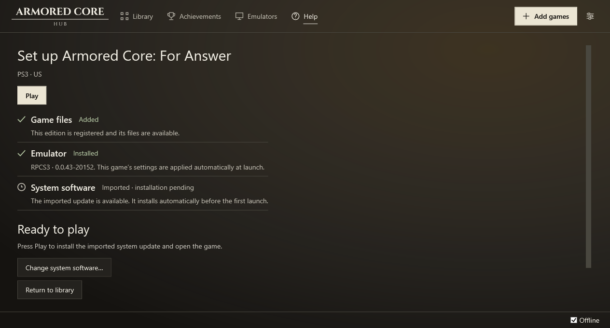
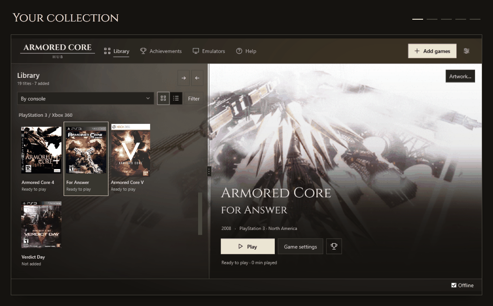
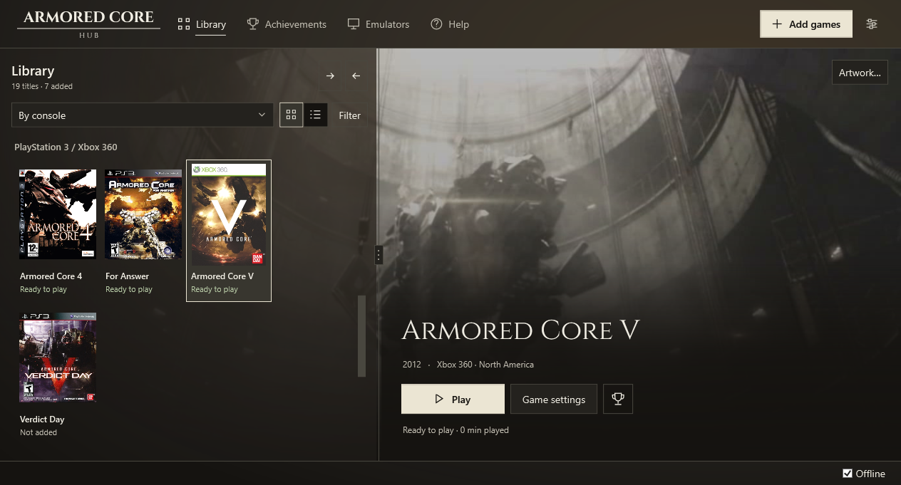
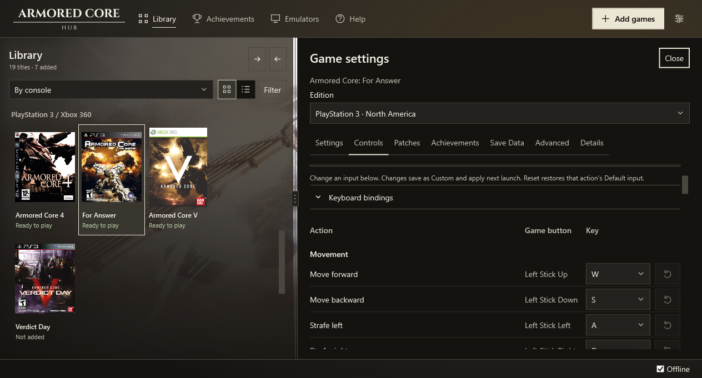
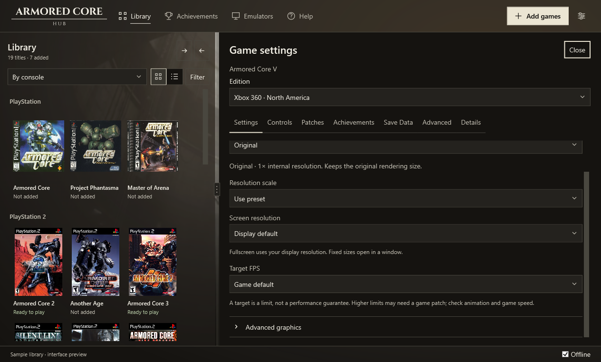
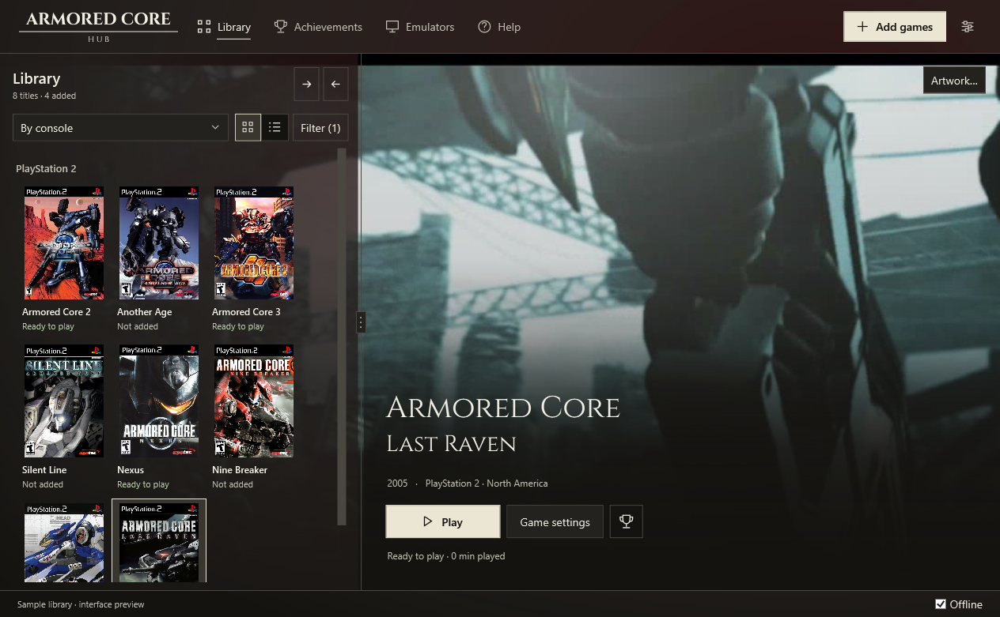

<picture>
  <source media="(prefers-color-scheme: dark)" srcset="docs/media/compact-dark.svg">
  
</picture>

Easiest way to enjoy Armored Core.

<p>
  <a href="https://github.com/peachyGT/armored-core-hub/releases">Download</a> ·
  <a href="docs/usage.md">User guide</a> ·
  <a href="https://github.com/peachyGT/armored-core-hub/issues/new?template=bug.yml">Report a bug</a> ·
  <a href="CONTRIBUTING.md">Contribute</a>
</p>

<p>
  <a href="https://github.com/peachyGT/armored-core-hub/actions/workflows/build.yml"></a>
  <a href="https://github.com/peachyGT/armored-core-hub/releases"></a>
  <a href="LICENSE"></a>
</p>



Add your Armored Core games and let the Hub handle emulator setup for you. It automatically downloads, installs and configures DuckStation, PCSX2, PPSSPP, RPCS3 and Xenia Canary for the supported PlayStation, PlayStation 2, PSP, PlayStation 3 and Xbox 360 editions.

**This is an early preview.** So far, the games we've tried in our autonomous harnesses launch and run at stable framerates on our test machines. Full playthroughs and every console/region edition aren't 100% confirmed yet. See [what we've tested](docs/testing/COVERAGE.md), the [feature matrix](docs/feature-matrix.md) and [known limits](BLOCKED.md).

Please submit issues you're having in the [issue tracker](https://github.com/peachyGT/armored-core-hub/issues) using the [bug-report form](https://github.com/peachyGT/armored-core-hub/issues/new?template=bug.yml). Your Hub version, steps and what went wrong are enough to start; logs or screenshots help.

## What it does

- Identifies your game files and regional editions, including games inside supported ZIP, 7z and RAR archives.
- Downloads, installs and sets up emulators automatically and keeps settings separate for each edition. Games share an installed emulator.
- Groups the library by console or generation, with an adjustable library pane and cinematic video backgrounds when your game supports them.
- Tracks supported native trophies and achievements, or RetroAchievements sets where available. Not every game has a set.
- Tracks your playtime in each game.
- Lets you edit keyboard and controller bindings by game action, with separate Default, Community, Custom and imported profiles for each game.
- Provides graphics settings, patch management and verified save backups.
- Warns before closing a running game and stops emulator/helper processes launched by the Hub when it exits.

## How do I use this?

1. Download the Windows x64 ZIP from [Releases](https://github.com/peachyGT/armored-core-hub/releases) and extract it into a writable folder.
2. Run `ArmoredCoreHub.exe`. The package includes .NET; no separate installation is needed.
3. Choose **Add games** and select the folder where your games are located.
4. Follow the selected game's prompts to have the Hub install its emulator and add any required system files, then click **Play**.
5. Enjoy!

The checklist shows what's done and what your selected game still needs.

[](docs/media/setup.png)

Windows 10 or 11 x64 is required. Emulator hardware requirements still apply. PS1 and PS2 need compatible BIOS dumps; PS3 uses official system software, which the Hub can download. ZIP and 7z BIOS imports are supported. See the [user guide](docs/usage.md) for formats, settings and troubleshooting.

## A look inside



### PS3 and Xbox 360 games

[](docs/media/later-generations.png)

### Change bindings by game action

[](docs/media/controls.png)

### Graphics settings for each game

[](docs/media/graphics.png)

### Earlier generations

[](docs/media/ps2-library.png)

## Build

Install the [.NET 10 SDK](https://dotnet.microsoft.com/download/dotnet/10.0), then run:

```powershell
.\scripts\build.ps1 -Test -Publish
```

Tests use synthetic media. Real games, BIOS, firmware, saves and account credentials are not test fixtures. The [architecture](docs/architecture.md) and [contribution guide](CONTRIBUTING.md) describe the source layout and checks.

## License and legal

Hub code is [MIT licensed](LICENSE). Fonts, libraries and other components retain their [own licenses](THIRD-PARTY-NOTICES.md).

Use only game files and system dumps you are legally entitled to use. The Hub does not supply commercial games or BIOS files. Emulator binaries and PS3 firmware are not bundled. No game files or reusable artwork collection are included in the download. We do NOT condone or support piracy. Read the [legal notice](LEGAL.md). 

This is an independent project, unaffiliated with FromSoftware, Bandai Namco, Sony, Microsoft or emulator authors.
