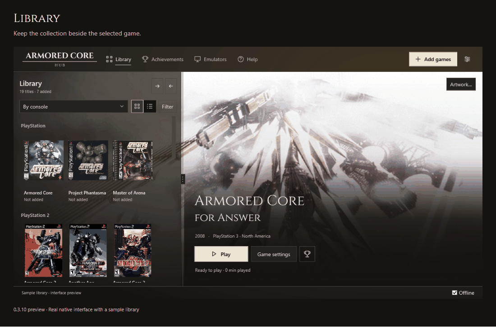
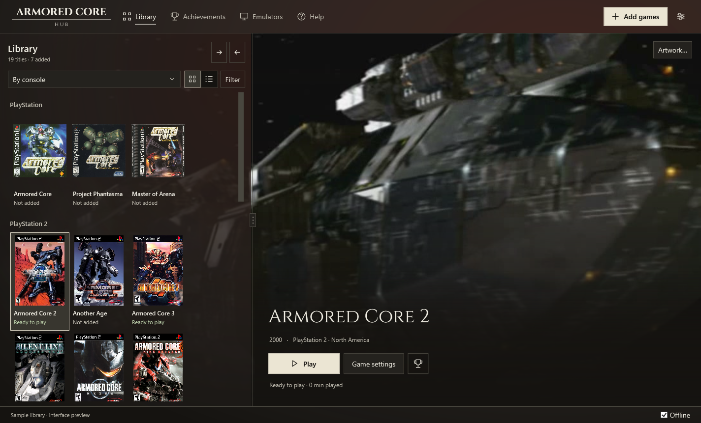
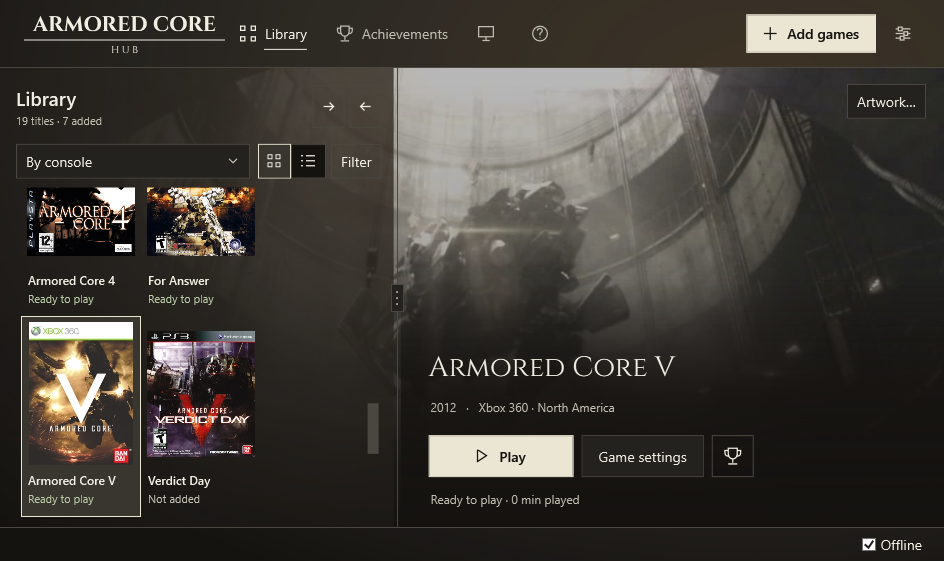

<picture>
  <source media="(prefers-color-scheme: dark)" srcset="docs/media/compact-dark.svg">
  
</picture>

Easiest way to enjoy Armored Core.

<p>
  <a href="https://github.com/peachyGT/armored-core-hub/releases">Download</a> ·
  <a href="docs/usage.md">User guide</a> ·
  <a href="https://github.com/peachyGT/armored-core-hub/issues">Report a bug</a> ·
  <a href="CONTRIBUTING.md">Contribute</a>
</p>

<p>
  <a href="https://github.com/peachyGT/armored-core-hub/actions/workflows/build.yml"></a>
  <a href="https://github.com/peachyGT/armored-core-hub/releases"></a>
  <a href="LICENSE"></a>
</p>


Automatically and easily install literally any game in the series. No more messing around with emulators. The Hub covers PlayStation, PlayStation 2, PSP, PlayStation 3 and Xbox 360 editions through DuckStation, PCSX2, PPSSPP, RPCS3 and Xenia Canary.

**This is an early preview.** So far, I've confirmed that all games launch and work at stable framerates on my machines; full back to back game completion isn't 100% confirmed yet. See the [feature matrix](docs/feature-matrix.md) and [known limits](BLOCKED.md) before relying on a particular feature or game. Please submit issues you're having in the issue tracker using this template. 

## What it does

- Identifies your game files and regional editions, including games inside supported ZIP, 7z and RAR archives.
- Downloads, installs and sets up emulators automatically and keeps settings separate for each edition. Games share an installed emulator.
- Groups the library by console or generation, with an adjustable library pane and cinematic video backgrounds when your game supports them.
- Tracks supported native trophies and achievements, or RetroAchievements sets where available. Not every game has a set.
- Tracks your playtime in each game.
- Lets you edit keyboard and controller bindings by game action (Per game), with separate Default, Community, Custom and imported profiles.
- Provides graphics settings, patch management, verified save backups and time played.
- Warns before closing a running game and stops emulator/helper processes launched by the Hub when it exits.

## A look inside



The captures show the real native interface in an isolated preview copy. No game was launched to make them. Game artwork belongs to its respective owners; no game files or reusable artwork collection are included in the download.

| Library across generations | Compact game view |
| --- | --- |
| [](docs/media/early-generations.png) | [](docs/media/compact-game.png) |
| Keep editions grouped while the scene fills the remaining space. | The same library and game actions adapt to a smaller window. |

| Edit bindings by action | Per-game graphics settings |
| --- | --- |
| [](docs/media/controls.png) | [](docs/media/graphics.png) |
| Each row shows the action, game button and binding, with its own reset. | Rendering scale, window resolution and supported FPS targets stay separate. |

<details>
<summary>More screenshots: the PS2 library and setup checklist</summary>


</details>

## How do I use this?

1. Download the Windows x64 ZIP from [Releases](https://github.com/peachyGT/armored-core-hub/releases) and extract it into a writable folder.
2. Run `ArmoredCoreHub.exe`. The package includes .NET; no separate installation is needed.
3. Choose **Add games** and select a folder where your games are located or collection folder.
4. Follow the selected game's prompts to have the Hub install its emulator and add any required system files, then click **Play**.
5. Enjoy!

Windows 10 or 11 x64 is required. Emulator hardware requirements still apply. PS1 and PS2 need compatible BIOS dumps. ZIP and 7z BIOS imports are supported. See the [user guide](docs/usage.md) for formats, settings and troubleshooting.

## Build

Install the [.NET 10 SDK](https://dotnet.microsoft.com/download/dotnet/10.0), then run:

```powershell
.\scripts\build.ps1 -Test -Publish
```

Tests use synthetic media. Real games, BIOS, firmware, saves and account credentials are not test fixtures. The [architecture](docs/architecture.md) and [contribution guide](CONTRIBUTING.md) describe the source layout and checks.

## License and legal

Hub code is [MIT licensed](LICENSE). Fonts, libraries and other components retain their [own licenses](THIRD-PARTY-NOTICES.md).

Use only game files and system dumps you are legally entitled to use. The Hub does not supply commercial games or BIOS files. Emulator binaries and PS3 firmware are not bundled. We do NOT condone or support piracy. Read the [legal notice](LEGAL.md).

This is an independent project, unaffiliated with FromSoftware, Bandai Namco, Sony, Microsoft or emulator authors.
